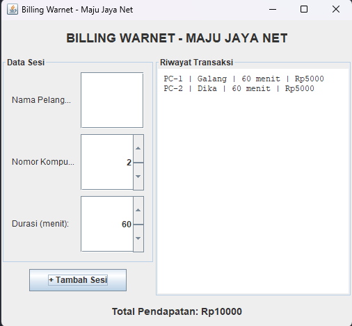

# Billing Warnet - Pemrograman Berorientasi Objek

Aplikasi GUI sederhana untuk mencatat sesi dan menghitung biaya pelanggan warnet menggunakan Java Swing.

## Struktur File
1. `Pelanggan.java`: Kelas data pelanggan dan logika perhitungan biaya.
2. `FormBilling.java`: Kelas antarmuka pengguna (GUI) dan penanganan event.
3. `Main.java`: Kelas main program.

## 5 Komponen Utama GUI yang Digunakan

1. **Top-Level Container Class**
   - `JFrame`: Jendela utama aplikasi billing pada class `FormBilling`.
   - `JOptionPane`: Dialog interaktif untuk notifikasi dan peringatan validasi input.

2. **Intermediate Container Class**
   - `JPanel`: Untuk mengelompokkan area input (`panelInput`), tombol (`panelTombol`), dan panel atas (`panelAtas`).
   - `JScrollPane`: Untukn fitur scroll untuk menampilkan riwayat transaksi pada `JTextArea`.

3. **Atomic Component Class**
   - `JLabel`: Menampilkan teks label input dan label total pendapatan.
   - `JTextField`: Kotak teks untuk input nama pelanggan.
   - `JSpinner`: Komponen angka untuk memilih nomor komputer dan durasi sesi.
   - `JButton`: Tombol aksi untuk menambah sesi dan mereset semua data.
   - `JTextArea`: Area teks multi-baris untuk menampilkan riwayat transaksi sesi.

4. **Layout Classes**
   - `BorderLayout`: Tata letak utama jendela dan panel atas (posisi `NORTH`, `CENTER`, `SOUTH`).
   - `GridLayout`: Tata letak grid 3 baris x 2 kolom pada panel input.
   - `FlowLayout`: Tata letak sejajar tengah pada panel tombol aksi.

5. **Event Listener**
   - Interface: ActionListener
   - Method Override: @Override public void actionPerformed(ActionEvent e)
   - Implementasi: Menangani klik tombol "Tambah Sesi" (validasi, membuat objek Pelanggan, menghitung biaya, memperbarui tampilan) dan tombol "Reset Semua" (membersihkan seluruh data).

## Screenshot Tampilan

